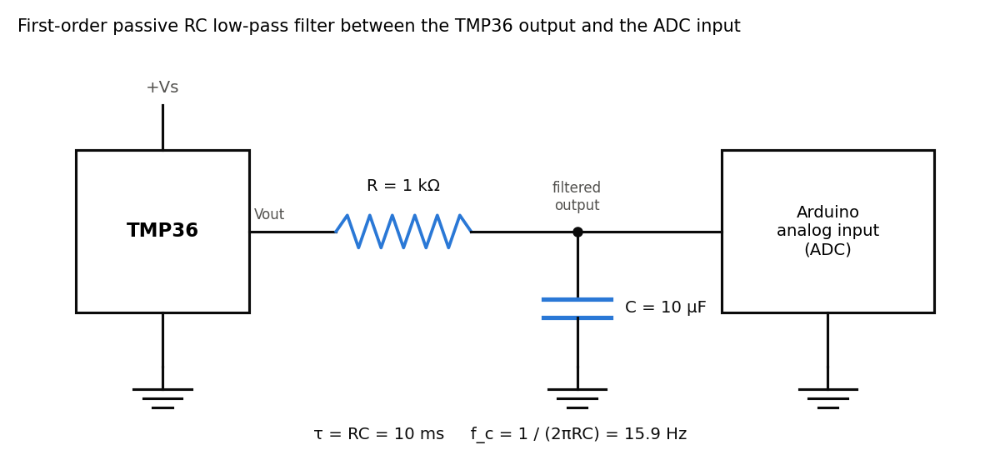
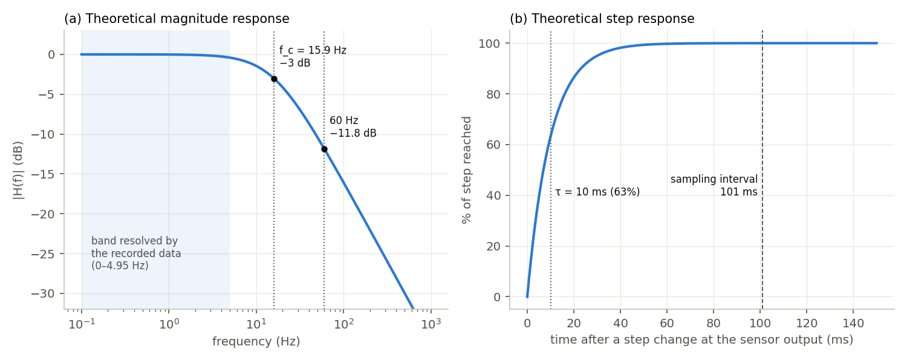
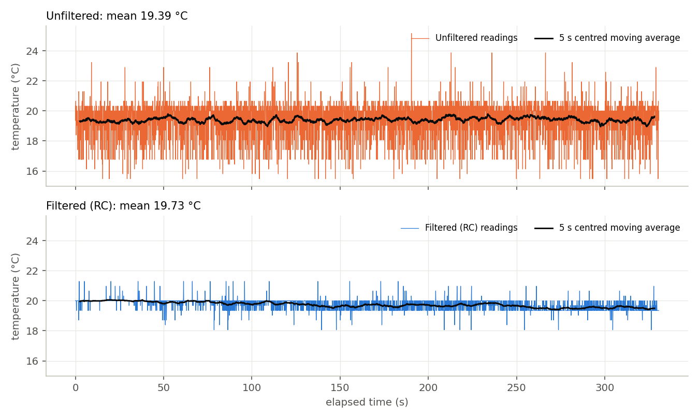
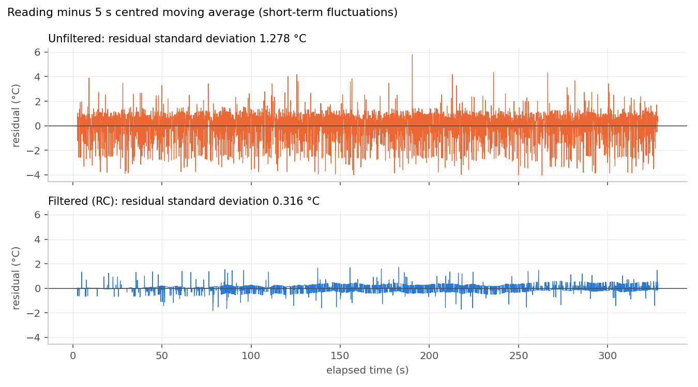
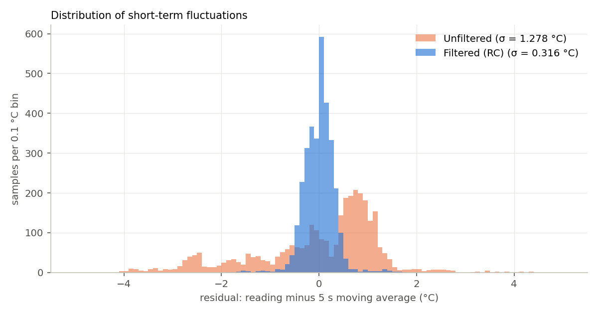

# RC Low-Pass Filter for an Analog Temperature Sensor

[](https://github.com/AdeevWohl/temperature-sensor-noise-filter/actions/workflows/tests.yml)

A first-order passive RC low-pass filter (1 kΩ, 10 µF) placed between a TMP36 analog temperature sensor and an Arduino analog input, and a measurement of how much it reduces short-term fluctuations in the recorded temperature.

**Main result (room temperature, measured):** the standard deviation of short-term fluctuations, after removing slow drift with a 5 s moving average, fell from **1.278 °C** without the filter to **0.316 °C** with it, a **75.3% reduction**.

> **Research context:** Independent project in Prof. Alberto Belloni's experimental particle physics group at the University of Maryland, which works on the **CMS High-Granularity Calorimeter (HGCAL)** upgrade. I was assigned to investigate reducing noise in temperature instrumentation used for cold-chamber testing. I presented the results to Prof. Belloni and colleagues at the group's internal weekly research meeting.

---

## My role

I carried out the project independently with minimal supervision:

- designed the filter and chose the component values;
- built the circuit and connected it between the TMP36 output and the Arduino analog input;
- recorded matched runs with and without the filter ([`scripts/room_logger.py`](scripts/room_logger.py));
- wrote the analysis ([`scripts/filter_analysis.py`](scripts/filter_analysis.py), [`scripts/run_analysis.py`](scripts/run_analysis.py)) and evaluated the filter quantitatively.

## Circuit and design rationale



The TMP36 outputs a voltage proportional to temperature (10 mV/°C, 0.5 V at 0 °C). The resistor is in series with that output, and the capacitor runs from the filtered node to ground, which forms a first-order low-pass filter in front of the ADC input.

**Why a low-pass filter.** Temperature in a room or a chamber changes over seconds to minutes, while electrical noise on the signal line extends to much higher frequencies. A low-pass filter removes the fast components and passes the slow temperature signal almost unchanged.

**Time constant and cutoff.**

$$\tau = RC = 1\ \text{k}\Omega \times 10\ \mu\text{F} = 10\ \text{ms}, \qquad f_c = \frac{1}{2\pi RC} = 15.9\ \text{Hz}$$

**Frequency response.** The magnitude of the transfer function is

$$|H(f)| = \frac{1}{\sqrt{1 + (f/f_c)^2}},$$

flat well below $f_c$, −3 dB at $f_c$, then falling at 20 dB per decade. At 60 Hz it is 0.256 (−11.8 dB).

**Noise suppression vs. response time.** A larger RC lowers $f_c$ and suppresses more noise, but the filter then takes longer to follow a real change. A step at the sensor output reaches 63% after τ = 10 ms and 99% after about 46 ms, well within one sampling interval (101 ms), so this filter does not measurably slow the recorded response. A 100 µF capacitor (f_c = 1.6 Hz, τ = 0.1 s) would give stronger smoothing with a response comparable to the sampling interval; it was not available and was not tested.



## Method

- **Hardware.** The same TMP36 sensor and Arduino (a GIGA R1, as recorded in the original analysis script) were used for both runs; the only change was inserting or removing the RC filter. The Arduino streamed `time_ms, raw, voltage, temp_C` over serial at 9600 baud, recorded by `room_logger.py`. The logged values follow T = 100 °C/V × (V − 0.5 V), and the raw counts and voltages imply 3.226 mV per ADC count (consistent with a 10-bit conversion over 3.3 V), i.e. **0.32 °C per count**.
- **Runs.** One unfiltered and one filtered run at room temperature, recorded one after the other: 3,273 samples each, 330.6 s, at 9.90 Hz (from the median sampling interval).
- **Separating drift from fluctuations.** Each reading minus a centred 5 s moving average (50 samples). Samples near the ends without a complete window are excluded (3,224 of 3,273 remain). The standard deviation of these residuals is the noise metric.

## Results

| | Unfiltered | Filtered | Reduction |
|---|---|---|---|
| Mean temperature | 19.39 °C | 19.73 °C | |
| **Residual standard deviation** | **1.278 °C** | **0.316 °C** | **75.3%** |
| Sample-to-sample difference std | 2.023 °C | 0.443 °C | 78.1% |
| Distinct ADC codes recorded | 25 | 11 | |

The sample-to-sample difference does not depend on the moving-average window and shows the same reduction. Full output: [`results/summary.md`](results/summary.md).







## Interpretation and limitations

- **What was measured.** The 75.3% figure is the reduction in the standard deviation of short-term fluctuations after removing slow drift. It is not an improvement in absolute temperature accuracy, which is set by the sensor's calibration (the TMP36 is specified to about ±2 °C). The 0.34 °C difference in mean temperature between the runs is about one ADC count and is not interpreted.
- **Sequential runs.** The runs were recorded one after the other, not simultaneously, so changes in room temperature or electrical interference between them cannot be excluded. Each condition was measured once, so the run-to-run spread of the result is unknown.
- **Room temperature only.** Both runs were at about 19-20 °C. The filter has not been tested inside the cold chamber, where cabling, interference from the chamber's equipment and the temperature behaviour of the components could differ.
- **Frequency content.** At 9.90 Hz the data can only resolve fluctuations up to 4.95 Hz, so they cannot show 60 Hz interference directly. Within 0-4.95 Hz the ideal RC response attenuates by at most 4.5% (0.4 dB), so the 75% reduction is not explained by the filter attenuating slow signals directly. It is consistent with the filter removing noise above the Nyquist frequency that would otherwise alias into the sampled band (the firmware is not available, so any digital averaging it applied is unknown). The data cannot identify the source of that noise (mains interference or otherwise); the −11.8 dB at 60 Hz is theoretical.
- **ADC resolution.** One ADC count is 0.32 °C, and the filtered residual is about one count, so further improvements would be limited by the ADC resolution. The ADC codes are also unevenly populated (e.g. code 208 never appears in the unfiltered run), a sign of differential nonlinearity that affects noise estimates at this level.
- **Detrending choice.** The result depends on the 5 s window that defines "short-term". With an even window, pandas' centred average sits half a sample off-centre, which shifts the residuals by a constant and does not affect their standard deviation.

## Reproducing the analysis

```bash
pip install -r requirements.txt
python scripts/run_analysis.py      # figures/ and results/summary.md
pytest                              # or: python tests/test_filter_analysis.py
```

Recording new data (needs `pip install pyserial` and the Arduino streaming the same CSV format):

```bash
python scripts/room_logger.py --port COM3 --samples 3273 --out room_filtered.csv
```

## Repository layout

```
data/room_unfiltered.csv, room_filtered.csv   original measurements (time_ms, raw, voltage, temp_C)
scripts/filter_analysis.py                    RC theory and residual-noise analysis
scripts/run_analysis.py                       figures and results summary
scripts/room_logger.py                        serial logger used to record the runs
tests/test_filter_analysis.py                 tests for the filter formulas, residuals and noise reduction
figures/, results/                            generated outputs
```

The Arduino firmware is not included.
